# Morpho Market

A store for [Mobium](https://github.com/mobiumdev/mobium) merch, built
natively twice, in **SwiftUI** for iOS and **Jetpack Compose** for Android,
and for TVs: **Fire TV**, Android TV and Google TV, and **Apple TV**, driven
with a remote. It
is an *app under test*: a full checkout with discount codes, tax and
shipping, and a switch of **deliberate bugs** that a test suite can be
scored against.

Nothing is for sale. The catalog, prices and orders are local, and there is
no network, so a run is deterministic and works offline.

## See it run

One Mobium test, checkout test **A** from `tests/checkout.test.json`, on
both platforms: two Logo Tees and a mug, the code WELCOME10, standard
shipping to New York, the spec's test card. It asserts every line of the
summary and places the order. The same test file drives both apps.
Shown at double speed.

| Android (Jetpack Compose) | iOS (SwiftUI) |
|---|---|
| 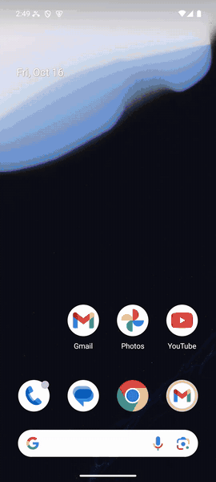 | 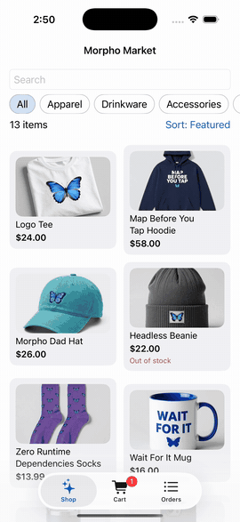 |
| [Full run, MP4](docs/media/android-checkout.mp4) | [Full run, MP4](docs/media/ios-checkout.mp4) |

The screens the test passes through, Android above and iOS below:

| Catalog | Product | Cart | Placed |
|---|---|---|---|
| 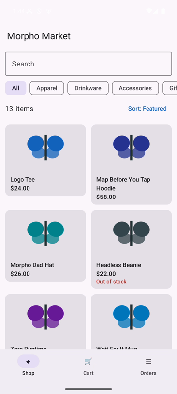 | 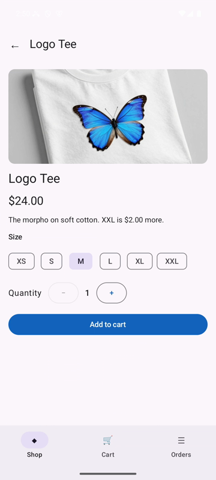 | 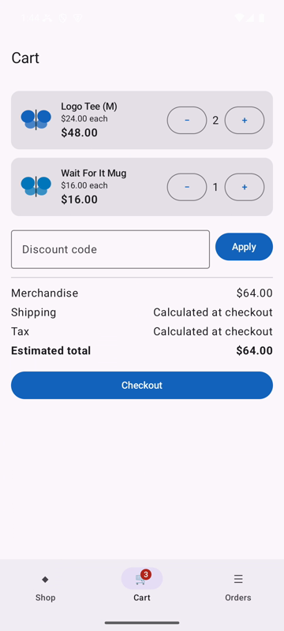 | 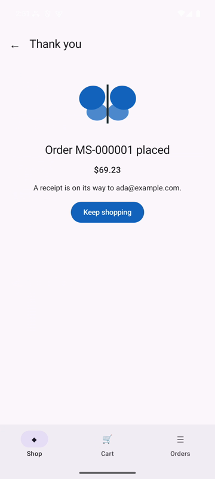 |
| 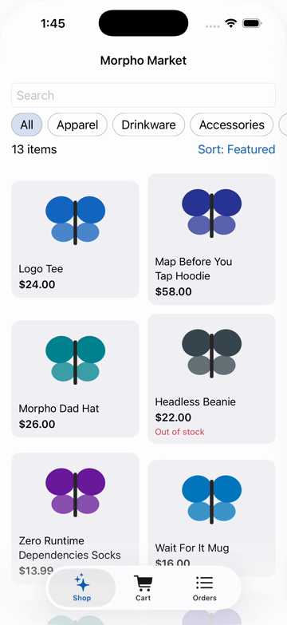 | 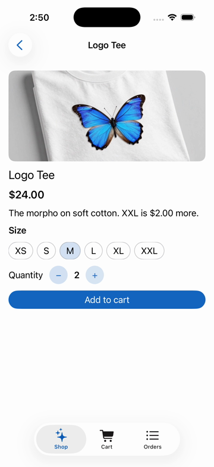 | 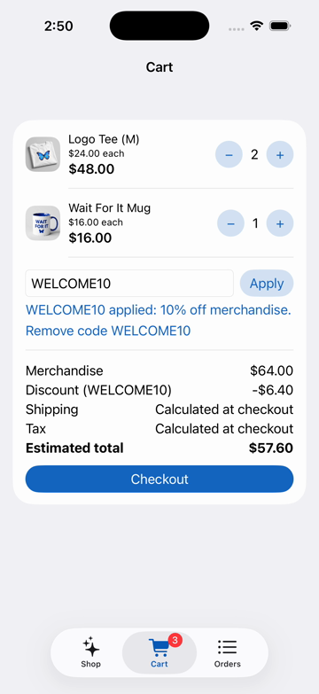 | 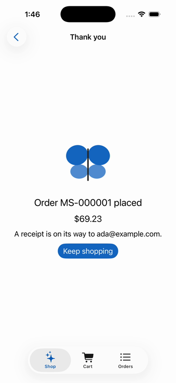 |

**On a TV**, the same checkout with the remote (`tests-tv/tv.test.json`):
every move a D-pad press, every choice a select, and a check after each press
of where focus went. Shown at double speed.

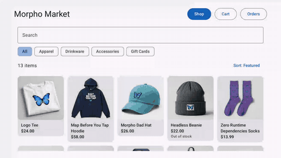

[Full run, MP4](docs/media/tv-checkout.mp4)

| Catalog | Product | Cart | Review | Placed |
|---|---|---|---|---|
| 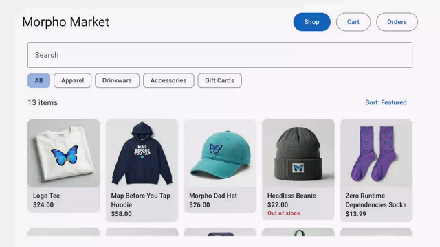 | 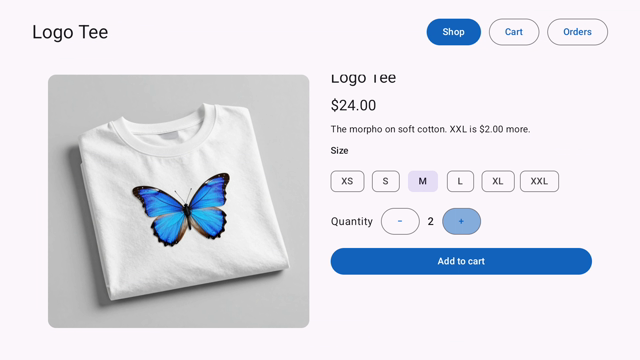 | 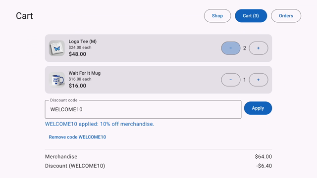 | 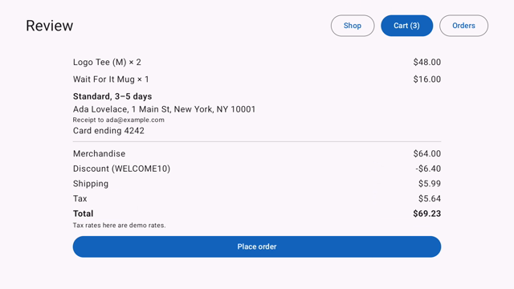 | 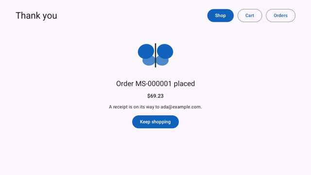 |

**On a Meta Quest**, the Android app unchanged, as a panel on the Meta
Spatial Simulator (Horizon OS): checkout test **A** again, and the price
range, whose two thumbs are dragged on a panel drawn 2.48 times its size.
Shown at double speed.

| Checkout test A | A price range narrows the catalog |
|---|---|
| 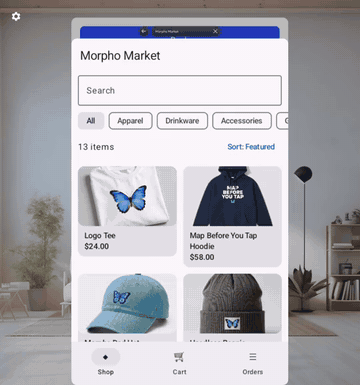 | 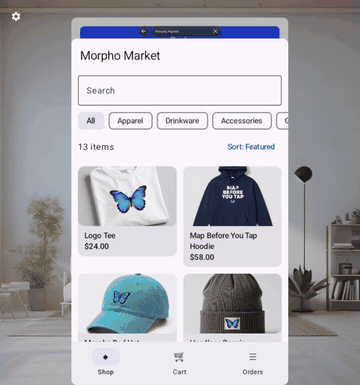 |
| [Full run, MP4](docs/media/quest-checkout.mp4) | [Full run, MP4](docs/media/quest-price-range.mp4) |

| Catalog | Product | Cart | Placed |
|---|---|---|---|
| 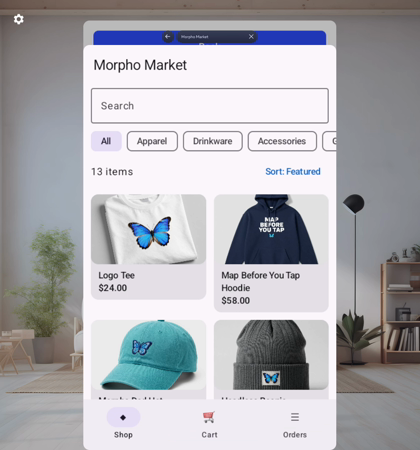 | 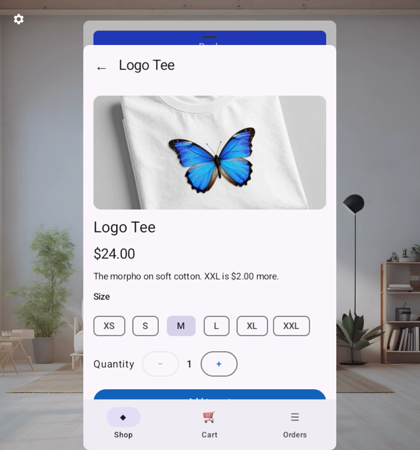 | 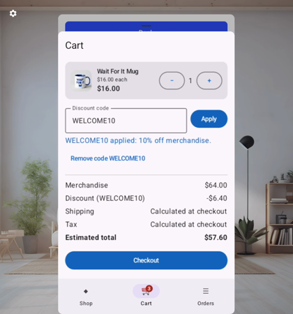 | 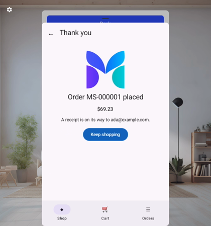 |

The product photographs were generated with an open model; how, and every
prompt, is in [docs/product-images.md](docs/product-images.md).

Recorded on an Android 15 emulator, an iPhone 17 Pro simulator (iOS 26.5)
and an Android TV emulator (Android 14, 1080p), with Mobium at `74ce9e9`. The Quest runs
were recorded on the Meta Spatial Simulator 207.0.0.83.331 with Mobium at
`c5f0c6f`.

## Contents

- [See it run](#see-it-run)
- [Why it exists](#why-it-exists)
- [What is in it](#what-is-in-it)
- [Build and install](#build-and-install)
- [On a TV](#on-a-tv)
- [On an Apple TV](#on-an-apple-tv)
- [On a Meta Quest](#on-a-meta-quest)
- [Run the tests](#run-the-tests)
- [The bug switch](#the-bug-switch)
- [Results](#results)
- [License](#license)

## Why it exists

Mobium drives mobile apps for AI agents and people. Its own app under test,
[MobiumApp](https://github.com/mobiumdev/mobium-app), is React Native, and
its demo is Flutter. SwiftUI and Jetpack Compose had been met only in other
people's apps, where nothing can be changed or switched on. Morpho Market is
a native pair of our own, so both toolkits have a positive control.

A checkout is what tests most often cover in the field, and it puts most of
what a tool has to handle on one path: lazy lists, menus, pickers, steppers,
sheets, alerts, the keyboard over a form, disabled buttons, a slow step, a
password-like field, and arithmetic a test must check.

Building it found five defects in Mobium, all fixed: mobiumdev/mobium #213
to #217, the last reproduced and confirmed in #218.

## What is in it

| Path | What it is |
|---|---|
| [SPEC.md](SPEC.md) | The spec: catalog, pricing rules with worked examples, screens, ids, and the bug switch |
| `spec/` | The pricing rules as a reference (`pricing.py`), the catalog, and the shared pricing cases |
| `android/` | Four Gradle modules: `shared`, the store's logic (catalog, pricing, checkout, the bug switch), whose unit tests run the shared cases; `ui`, the screens and product photographs; `app`, the phone app (`dev.mobium.shop`); and `tv`, the TV app (`dev.mobium.shop.tv`) |
| `ios/` | The SwiftUI app (`dev.mobium.shop`), an XcodeGen project, with unit tests over the same cases |
| `tests/` | One Mobium test suite for both phone platforms (`shop.test.json`, 14 tests; `checkout.test.json`, 11 tests), the configs, and the bug matrix (`matrix.sh`, `score.py`) |
| `tests-tv/` | The TV's test, driven with the remote (`tv.test.json`), and its config. A folder of its own: `mobium test` reads every test file under the folder it is given |
| `evidence/` | The bug matrix's results on both platforms; see [evidence/README.md](evidence/README.md) |

Both apps use the same accessibility ids, the same text and the same prices,
so one test file drives both. No third-party dependencies in either app:
Jetpack and Apple frameworks only. Money is integer cents everywhere.

## Build and install

**The pricing reference** (Python 3):

```sh
python3 spec/pricing.py     # checks the spec's worked examples against the rules
```

**Android** (JDK 17 or later, the Android SDK, an emulator or phone):

```sh
cd android
./gradlew :shared:testDebugUnitTest :app:assembleRelease
adb install -r app/build/outputs/apk/release/app-release.apk
```

The release build is signed with the debug key: an app under test, installed
by hand, never published.

**iOS** (Xcode 26 and [XcodeGen](https://github.com/yonaskolb/XcodeGen), an
iOS simulator):

```sh
cd ios
xcodegen generate
xcodebuild test -project MorphoMarket.xcodeproj -scheme MorphoMarket \
  -destination 'platform=iOS Simulator,id=<udid>'
xcodebuild -project MorphoMarket.xcodeproj -scheme MorphoMarket -configuration Release \
  -sdk iphonesimulator -destination id=<udid> -derivedDataPath build build
xcrun simctl install <udid> "build/Build/Products/Release-iphonesimulator/Morpho Market.app"
```

For an iPhone, set `DEVELOPMENT_TEAM` in `ios/project.yml` to your team id
before `xcodegen generate`.

**A TV** (the same toolchain as Android; a Fire TV, an Android TV, or Google's
Android TV emulator image, `system-images;android-34;android-tv;arm64-v8a`):

```sh
cd android
./gradlew :tv:assembleRelease
adb install -r tv/build/outputs/apk/release/tv-release.apk
```

On a Fire TV, open Settings > Device & Software (My Fire TV on older Fire
OS) > About and select the device's name seven times; then turn on ADB
Debugging under Developer Options, and `adb connect <tv-address>:5555` before
installing. The app runs on Android 7.1 and later,
which is Fire OS 6, 7 and 8. On the Android TV emulator it is listed under
Installed Apps with its banner. It has not yet been run on a real Fire TV.

**An Apple TV** (the iOS toolchain, with the tvOS simulator platform:
`xcodebuild -downloadPlatform tvOS`):

```sh
cd ios
xcodegen generate
xcodebuild -project MorphoMarket.xcodeproj -scheme MorphoMarketTV -configuration Release \
  -destination 'generic/platform=tvOS Simulator' -derivedDataPath build build
xcrun simctl install <apple-tv-udid> "build/Build/Products/Release-appletvsimulator/Morpho Market.app"
```

The app id is the Fire TV app's, `dev.mobium.shop.tv`, and it runs on tvOS
17 and later. It has been run on the Apple TV 4K simulator, tvOS 26.5, and
not yet on a real Apple TV.

## On a TV

The TV app is the same store: the same catalog, prices, codes, bug switch and
screens, from the same `shared` and `ui` modules, so a price or a bug cannot
differ between the phone and the TV. What changes is what a remote needs:

- **Focus is the cursor.** Every control shows clearly which one has it, and
  the D-pad moves it. Back on the remote is the phone's back arrow.
- **A 1080p layout:** the catalog in five columns, a product's photograph
  beside its details, and forms centered at a readable width.
- **Back from a product returns focus to its card**, not to the search field
  at the top.
- **A text field opens on select.** Focus passes over a field without
  opening the keyboard, and select opens it. A field that opened its keyboard
  the moment focus arrived took every key after it, and the remote could not
  leave.
- **Done moves to the next field** in a form, instead of sending focus back
  to the top of the screen.
- **"Added to cart" stays while its View cart has focus.** It is gone after
  four seconds on a phone; a remote took longer than that to reach it.

The phone app shares those screens and behaves exactly as before: each change
applies only where a remote drives the app.

## On an Apple TV

The Apple TV app is the iPhone app's model and screens, compiled for tvOS
with a TV's layout: the same catalog, prices, codes and bug switch, from the
same Swift files, and the Fire TV app's bar across the top, its ids and its
app id. The remote's Menu button is Back, and coming back from a product
gives its card focus again, as tvOS does. What tvOS needed:

- **Every control is a button.** tvOS gives focus only to what can take it,
  so a card, a shipping option and an order are buttons on the TV.
- **The categories come first** on the catalog, so focus starts on them and
  the first press down reaches the first product.
- **A choice opens a sheet.** A menu's items carry no ids on tvOS, so the
  state and the sort order are buttons in a sheet there, focus on the first.
- **The email field asks for plain text.** tvOS answers an email keyboard
  with the email addresses the TV has been given before, so what select
  opens would depend on the TV's history.

| Catalog | Product | Cart | Review | Placed |
|---|---|---|---|---|
| 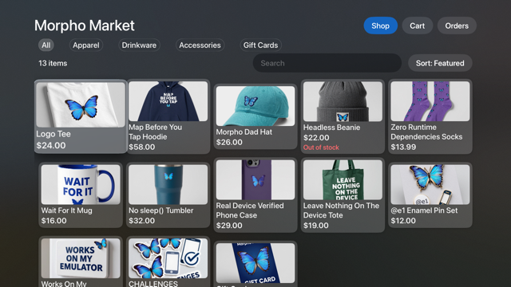 | 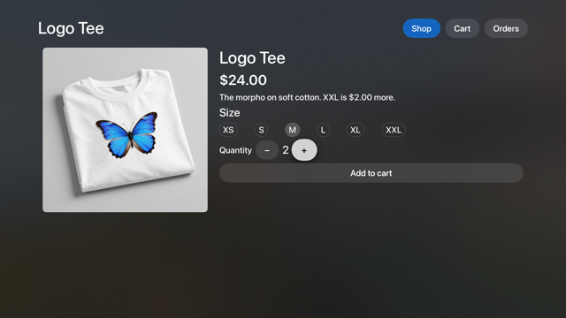 | 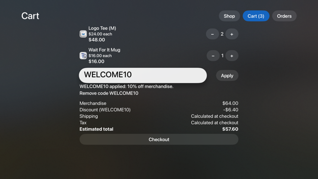 | 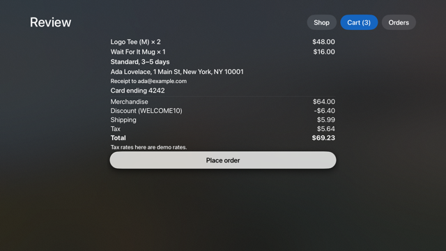 | 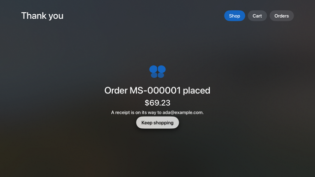 |

Its test, `tests-appletv/appletv.test.json`, is the Fire TV test's checkout
with the presses tvOS's focus engine takes: on a product page focus starts
on the first size, so M is right, right, where the Fire TV goes down, left.
Every assertion is the Fire TV test's, and the size chosen is read as
selected, which is what SwiftUI says it is. tvOS types into a keyboard
screen of its own: select opens it for the field with focus, `fill` types
there, and hiding it keeps the text.

## On a Meta Quest

There is no Quest build: the Android app runs unchanged on Horizon OS, where
it is a panel among others, 500×800 pixels drawn 2.48 times that size.
Mobium drives it there with the shared suite and `tests/quest.config.json`,
whose one project is the device `MOBIUM_QUEST_DEVICE` names:

```sh
MOBIUM_QUEST_DEVICE=emulator-5554 mobium test --config tests/quest.config.json
```

Two things the panel needed, both in Mobium rather than the app:

- **Every app is open at once.** The catalog's implicit scroll first went to
  the browser's page behind the store, and 1 test in 26 passed. Mobium now
  asks only the app in front (its CHALLENGES 367).
- **A drag goes further than the finger.** Compose moved the price range's
  thumbs about 2.4 times as far, so a fill read $0 for 0.25. Mobium's fill
  now learns how far a drag carries a thumb from its own drags and lands, or
  refuses one that did not (CHALLENGES 368).

One test changed for the panel: "out of stock" scrolls to Add to Cart, which
sits below the fold on a panel (#5). It has been run on the simulator only,
not a real headset.

## Run the tests

Install [Mobium](https://github.com/mobiumdev/mobium) (`go install
github.com/mobiumdev/mobium/cmd/mobium@latest`), then from the repository
root:

```sh
mobium test --config tests/mobium.config.json                            # Android, emulator-5554
MOBIUM_IOS_DEVICE=<udid> mobium test --config tests/ios.config.json      # iOS simulator
MOBIUM_TV_DEVICE=<serial> mobium test --config tests-tv/tv.config.json   # a TV, by its adb serial
MOBIUM_APPLETV_DEVICE=<udid> mobium test --config tests-appletv/appletv.config.json   # an Apple TV simulator
```

The Apple TV's test needs Mobium `9337299` or later
(mobiumdev/mobium#227, #228 and #229): typing through tvOS's keyboard
screen, a dialog rule answered with the remote, and the `selected`
condition.

Edit `tests/mobium.config.json` to name another Android device. The TV's
test is the phone suite's checkout test A, driven as a person on a sofa
would: every move is a D-pad press, every choice a select, and after each
press the test checks where focus went. Text is filled once a field is open,
as a TV's keyboard would type it.

## The bug switch

Sixteen deliberate bugs, each a plausible mistake in a checkout: a code
applied twice, tax taken before the discount, a declined card that places an
order, a price sort that compares text, and more. [SPEC.md](SPEC.md) lists
them all, with what each breaks. They are switched by a deep link:

```sh
mobium open "mobiumshop://bugs?on=sort-as-text"   # one bug on
mobium open "mobiumshop://bugs?off=all"           # every bug off
```

**The bug matrix** runs the suite with no bug on, then with each bug on
alone, and scores which tests catch each one. With no bug on, every test
must pass, or no other row means anything.

```sh
sh tests/matrix.sh out/android && python3 tests/score.py out/android
CONFIG=tests/ios.config.json DEVICE=<udid> MOBIUM_IOS_DEVICE=<udid> sh tests/matrix.sh out/ios
python3 tests/score.py out/ios
```

`MOBIUM` names a `mobium` binary other than the one on `PATH`.

## Results

On an Android 15 emulator and an iPhone 17 Pro simulator (iOS 26.5):

| | Android | iOS |
|---|---|---|
| The suite, no bug on | 26 of 26 | 26 of 26 |
| Bugs caught | **17 of 17** | **17 of 17** |

The suite ran on 2026-10-26 with Mobium at `c5f0c6f`, both apps built from
`main` (7 min 40 s on Android, 10 min 31 s on iOS). The bug matrix ran on the
25 tests the suite had before the price range (#4), with Mobium at `2e37123`,
the seventeenth bug at `bfcb09f`; a test added can only catch more. The same
tests catch each bug on both platforms. `slow-catalog`, a catalog that
appears after 8 seconds, fails every test on both. The seventeenth,
`stale-code-message`, was added on 2026-10-17.

**On a TV**, the one test (Android TV emulator, Android 14): with no bug on
it passes, and it catches 3 of the 16 bugs it was run against
(`slow-catalog`, `stale-badge`, `tax-before-discount`), exactly the bugs
the phone's checkout test A catches on its own. The other bugs are caught on the phones by tests the TV does not
have yet. The JUnit results and scores are in [evidence/](evidence/README.md).

**On a Meta Quest** (Meta Spatial Simulator, Horizon OS build 207), the
shared suite with no bug on: **26 of 26**, with Mobium at `c5f0c6f` (25 of 26
before its CHALLENGES 368). The bug matrix has not been run there.

## License

Apache License 2.0; see [LICENSE](LICENSE) and [NOTICE](NOTICE).
